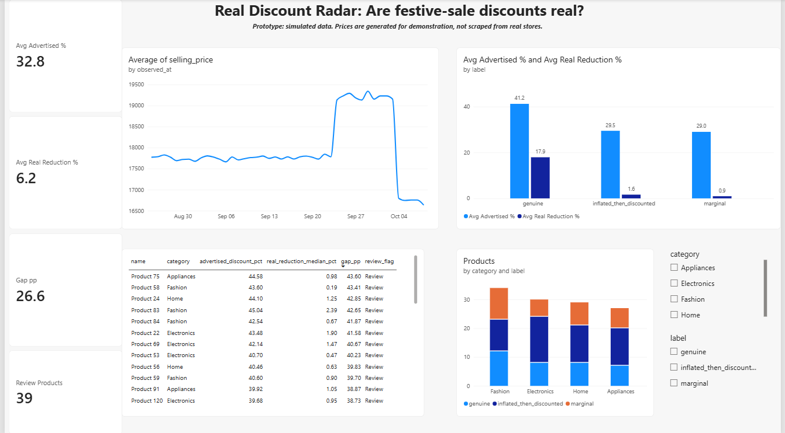

@'
# Real Discount Radar

**Are festive-sale discounts real?** A data analytics portfolio project that checks whether advertised sale discounts are genuine savings compared with each product's own price history.

> **Prototype notice:** all prices in this repository are **simulated**. They were generated by `scripts/generate_data.py` to build and test the method. Nothing here is a finding about any real store, seller or platform.

## The question

Are products advertised at a large discount during a sale actually cheaper than their own price before the sale?

Two measures are kept separate:

| Measure | Meaning |
|---|---|
| Advertised discount | Reduction claimed against the displayed reference price (MRP) |
| Historical price reduction | How much cheaper the sale price is than the product's own pre-sale price |

Example: if a product's usual price was 1,000 and its sale price is 900, the historical reduction is 10%, even if the listing claims 40% off MRP.

Offers are not labelled fraudulent. They are flagged as **potentially misleading and worth a closer look**, based on the available evidence.

## Data (simulated)

- 120 products in 4 categories (Electronics, Fashion, Home, Appliances)
- 45 daily prices per product, 25 Aug to 8 Oct 2026 (5,400 observations)
- Sale period: 4 to 8 Oct 2026
- Three price behaviours are planted on purpose: genuine discount, price raised before the sale then "discounted" back to normal, and flat. A hidden `true_behaviour` column is the answer key and is used only to test the classification.

## Method

1. **Validate and explore (Python):** checks for nulls, duplicates, prices above MRP and non-positive prices, plus price charts.
2. **Rolling 28-day benchmark (Python):** each price is compared with the average of the previous 28 days (evaluation day excluded, at least 21 valid observations). 2,040 product-date evaluations (120 products x 17 dates).
3. **Advertised vs historical (Python):** the gap between the advertised discount and the historical reduction, in percentage points.
4. **Pre-sale baseline (SQL and Python):** for each product, the mean, median and minimum price over the 28 days before the sale starts.
5. **Classification (SQL and Python):** each product gets one label, using the median baseline.
6. **Dashboard (Power BI):** advertised vs real discounts, price over time, categories and a review list.

### Why the median baseline

Some products raise their price in the 10 days before the sale. Those inflated days lift a plain average, so the sale price looks cheaper than it really is. The median resists this. For the inflated group, the mean-based reduction was 6.11% but the median-based one was 1.63%.

### Business rules

| Label | Rule |
|---|---|
| inflated_then_discounted | Pre-sale run-up >= 8% and real reduction (median baseline) < 5% |
| genuine | Real reduction (median baseline) >= 10% |
| marginal | Everything else |
| Review flag | Advertised discount >= 30% and real reduction < 5% |

Run-up = average price of the last 10 baseline days compared with the average of the first 18.

## Results (simulated data)

| Measure | Value |
|---|---|
| Average advertised discount (sale period) | 32.8% |
| Average real reduction vs median baseline | 6.2% |
| Average gap | 26.6 percentage points |
| Products flagged for review | 39 of 120 |

| Label | Products | Avg advertised | Avg real reduction |
|---|---|---|---|
| genuine | 35 | 41.2% | 17.9% |
| inflated_then_discounted | 53 | 29.5% | 1.6% |
| marginal | 32 | 29.0% | 0.9% |

- Only 35 of 120 products (about 29%) delivered a real saving of 10% or more.
- With the rolling 28-day method over all 17 evaluation dates, 49.46% of product-date evaluations were below their historical average. This mostly reflects normal price noise, which is why the sale-period, per-product view is used for conclusions.
- SQL and Python classifications agree on all 120 products.
- Category differences are small and come from random assignment in the simulation. They are not findings.

## Limitations

- **Simulated data.** Results show that the pipeline works, not how real marketplaces behave.
- **100% accuracy is not proof.** The classifier matched the answer key on all 120 products, but the thresholds (8%, 5%, 10%) were chosen knowing how the data was generated. Real data is noisier and accuracy would be lower. The result validates the pipeline, not the rules.
- **Single sale event** and a single 28-day baseline window.
- **MRP is treated as a displayed reference price**, not a true market price.
- **No coupons, bank offers or seller changes** are modelled.
- **Thresholds are judgement calls.** A sensitivity test across alternative thresholds would strengthen the conclusions.
- **Real data would need** repeated observations of the same product before the sale, collected within the terms of the source.

## 📊 Power BI Dashboard

### Dashboard Preview

[Download Dashboard Screenshot (PNG)](docs/dashboard.png)

### Download the Power BI Report

[Download Power BI Report (.pbix)](./real_discount_radar.pbix)